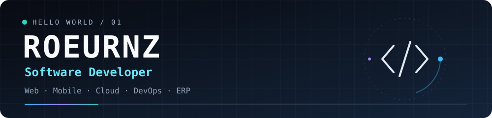
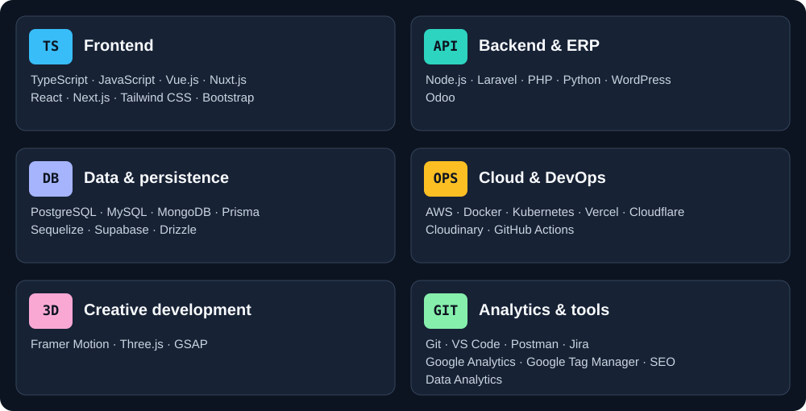

**From Phnom Penh, Cambodia 🇰🇭 · Building across the full stack**

## 👋 About

I'm a full-stack developer with 2+ years of experience and an interest in connecting great user experiences with maintainable backend services and reliable infrastructure.

**My focus:** Full-stack engineering · Microservices & REST APIs · Cloud-native delivery · ERP & business systems · Creative web development.

> Build with purpose. Keep systems understandable. Improve continuously.

## ⚡ Selected work

<table>
<tr>
<td width="50%" valign="top">

### [MyPortfolio](https://github.com/roeurnz/MyPortfolio)
Personal portfolio repository.

[Explore source →](https://github.com/roeurnz/MyPortfolio)
</td>
<td width="50%" valign="top">

### [Laravel + Vue + Docker](https://github.com/roeurnz/deploy-full-stack-laravel-vue-docker)
Full-stack project setup and deployment guide.

`Laravel` `Vue` `Docker`
</td>
</tr>
<tr>
<td valign="top">

### [Nuxt Starter](https://github.com/roeurnz/nuxtjs-v4-tailwind-v4)
Nuxt starter project for modern web development.

`Nuxt` `Tailwind CSS`
</td>
<td valign="top">

### [React Starter](https://github.com/roeurnz/reactjs-v19-tailwind-v4)
React, TypeScript and Vite starter project.

`React` `TypeScript` `Vite`
</td>
</tr>
</table>

[Explore all public repositories →](https://github.com/roeurnz?tab=repositories)

## 🛠️ Technology toolbox

View technology list

| Domain | Technologies |
| --- | --- |
| Frontend | TypeScript, JavaScript, Vue, Nuxt, React, Next.js, Tailwind CSS, Bootstrap |
| Backend & ERP | Node.js, Laravel, PHP, Python, WordPress, Odoo |
| Data | PostgreSQL, MySQL, MongoDB, Prisma, Sequelize, Supabase, Drizzle |
| Cloud & DevOps | AWS, Docker, Kubernetes, Vercel, Cloudflare, Cloudinary, GitHub Actions |
| Creative | Framer Motion, Three.js, GSAP |
| Analytics & tools | Git, VS Code, Postman, Jira, Google Analytics, Google Tag Manager, SEO, Data Analytics |

## 🧩 How I approach engineering

- **Architecture:** Clear service boundaries, reusable components and well-defined APIs.
- **Quality:** Readable code, testing, security and performance.
- **Delivery:** Automation, containers, CI/CD and reliable deployments.
- **Growth:** Continuous learning, collaboration and practical problem solving.

## 📊 GitHub activity

**[View live contribution history on GitHub →](https://github.com/roeurnz#contribution-activity)**

<!-- The native contribution calendar is maintained by GitHub below the profile README. No external activity-graph service is required. -->

---

**Let's build something meaningful.**

[roeurnz.com](https://www.roeurnz.com) · [LinkedIn](https://linkedin.com/in/roeurnkaki) · [Contact me](mailto:contact@roeurnz.com)

Made with curiosity, code and continuous improvement.

